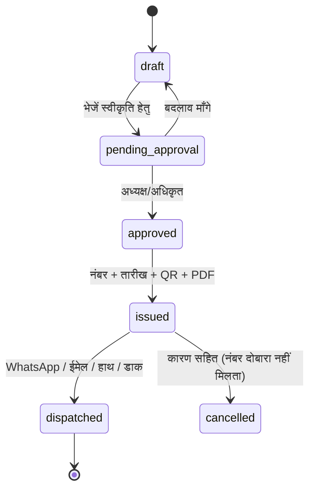

# Universal Design Studio + Document Workflow

## एक इंजन, सब दस्तावेज़
लेटरहेड, पत्र, नोटिस, प्रमाणपत्र, निमंत्रण, रसीद, वाउचर, सदस्यता कार्ड, पोस्टर, शोक पत्र, पत्रिका कवर और विज्ञापन, सब एक ही `design-engine` से बनेंगे। फ़र्क सिर्फ़ template और उसमें भरे जाने वाले fields का होगा।

### आधार: shokpatra `studio-engine.js` (पहले से चल रहा है)
पहले से है: layer model (text with **bold**, frame, rect, line, clip-art, image, name-field), auto layout + free editor, drag/resize/snap, undo/redo, layers panel (lock/hide), Devanagari fonts (Mukta, Tiro, Noto Serif), PNG export।

### Kalchuri One के लिए विस्तार
| नया | विवरण |
|---|---|
| Multi-page document | `{ pages: [{ size, bg, layers }], masters }`; लेटरहेड = master page (header/footer), जिस पर पत्र की सामग्री बहती है |
| Page sizes | A4, A5, Letter, ID card (85.6×54 mm), Square post, Custom (mm); 300 DPI export |
| Merge fields | `{{org.name}}`, `{{doc.ref_no}}`, `{{recipient.name}}`, `{{member.father}}`, `{{receipt.amount_words}}` आदि; शोकपत्र के `{नाम} {पिता} {गाँव}` इन्हीं में map होंगे |
| नए layers | QR (verify link), seal/stamp (PNG + opacity + rotate), signature (image + नाम + पद), table (बिल के items), rich-text block (पत्र का body, कई पेज तक बहे), watermark |
| Brand kit | संगठन का logo, रंग और fonts; हर template में अपने आप |
| Template library | साझा (super admin) + संगठन के अपने; duplicate, "reusable template के रूप में सहेजें" |
| Export | PNG/JPG, PDF (v1: image-PDF, हिंदी हमेशा सही), print-ready (bleed/margins) |

### Template सूची (शुरुआत में)
आधिकारिक लेटरहेड (3 डिज़ाइन), सामान्य पत्र, नियुक्ति पत्र, निमंत्रण पत्र, नोटिस, बैठक सूचना, प्रशंसा पत्र, धन्यवाद पत्र, दान अनुरोध, प्रायोजन प्रस्ताव, प्रमाणपत्र, प्रस्ताव दस्तावेज़, कार्यालय आदेश, प्रेस विज्ञप्ति, शोक पत्र (shokpatra के डिज़ाइन), सदस्यता पुष्टि, प्राधिकार पत्र, दान रसीद, वाउचर, सदस्यता कार्ड, निमंत्रण कार्ड, पत्रिका कवर।

## Document Workflow (हर प्रकार के लिए एक जैसा)

- **नंबर** issue के समय `docs.number_series` से (transaction में lock) मिलता है, ताकि कोई गैप या डुप्लिकेट न हो।
- **QR / verify**: `/verify/<code>` पर कोई भी पत्र या रसीद की सच्चाई जाँच सकता है (ekym के receipt-verify पेज का विस्तार)।
- **रसीद**: `issued` होते ही `fin` में voucher post होता है। cancel करने पर reversal entry बनती है, delete नहीं होता।
- **Dispatch**: `comms.messages` से WhatsApp/ईमेल, हर प्राप्तकर्ता की स्थिति, और आवक/जावक रजिस्टर में अपने आप entry।
- **Bulk**: एक template से कई प्राप्तकर्ता (निमंत्रण, शोक संदेश, प्रमाणपत्र)। shokpatra का village/family/lineage-wise picker दोबारा इस्तेमाल होगा।
