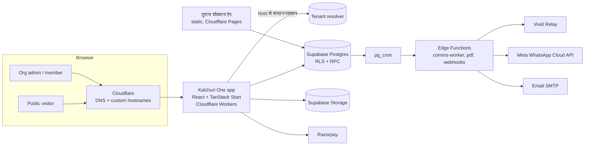

# System Architecture — Kalchuri One

## 1. एक नज़र में



- **एक ही app** (ekym codebase से शुरू): central portal, हर संगठन की public साइट और dashboard `/app`, तीनों एक साथ।
- **एक ही Supabase प्रोजेक्ट** (EKYM): शोकपत्र का असली डेटा यहीं है, इसलिए नया प्रोजेक्ट नहीं बनेगा। बाद में चाहें तो Supabase dashboard में प्रोजेक्ट का नाम "Kalchuri One" किया जा सकता है।
- **पुराना शोकपत्र ऐप** तब तक चलता रहेगा जब तक उसका हर फ़ीचर नए app में न आ जाए (Phase 6)।

## 2. Tenant (संगठन) पहचान

| URL | क्या खुलेगा |
|---|---|
| `kalchurione.in` (डोमेन तय करना बाकी) | central portal: सभी संगठन, central news/blog feed, निर्देशिकाएँ, signup |
| `ekym.kalchurione.in` | उस संगठन की public वेबसाइट |
| `ekym.org` (custom domain) | वही साइट, Cloudflare for SaaS custom hostname से |
| `kalchurione.in/app` | लॉगिन के बाद dashboard: org switcher, permission के हिसाब से menu |
| `kalchurione.in/admin` | super admin |

सर्वर middleware `Host` header से `org_domains` पढ़कर `organization_id` तय करता है। हर public query उसी org पर filter होती है, और RLS दूसरी परत की सुरक्षा देता है।

## 2a. भाषा
वेबसाइट default **English** में है; header में **हिंदी** toggle। UI के शब्द `src/core/i18n` dictionary से आते हैं, content के लिए DB में `*_hi` fields (जैसे `name_hi`)। भाषा का चुनाव cookie में रहता है, ताकि SSR भी सही भाषा में render करे।

## 3. Code ढाँचा (module-wise)

```
src/
  core/            auth, tenant resolver, permissions (can()), i18n hi/en, audit
  design-engine/   framework-agnostic TS: document model, layers, canvas renderer, PDF export, merge fields
  modules/
    org/           संगठन, hierarchy, सदस्यता, समिति, पद, विभाग
    gov/           बैठक, agenda, कार्यवृत्त, प्रस्ताव, कार्य, मतदान
    cms/           sites, pages (blocks), menus, posts (blog/news/press), categories, comments, media
    publishing/    पत्रिका, issues, flipbook
    documents/     पत्र, नंबर-शृंखला, स्वीकृति, dispatch, आवक/जावक रजिस्टर
    finance/       खाते, वाउचर, रसीद, बिल, FY, रिपोर्ट, Razorpay
    events/        कार्यक्रम, निमंत्रण, guests, RSVP, attendance
    family/        वंश वृक्ष, सामाजिक क्षेत्र, मूल ग्राम (shokpatra से port)
    shok/          शोक संदेश (shokpatra send flow)
    comms/         WhatsApp/email channels, templates, consent, queue, reports
    community/     रक्तदान, वैवाहिक, व्यापार, रोज़गार, छात्रवृत्ति, लाइब्रेरी, वॉलंटियर
    ads/           slots, campaigns, AdSense, revenue
  routes/          TanStack file routes (public site, /app, /admin)
supabase/migrations/   हर module की अलग migration
docs/kalchuri-one/     यह documentation
```

हर module में अपनी `api.ts` (server functions + queries), `components/`, `schema.ts` (zod) और `permissions.ts` होगी। Module दूसरे module की टेबल सीधे नहीं बदलेगा, बल्कि उसकी RPC/function के ज़रिए बात करेगा (जैसे रसीद जारी → `finance.post_receipt()`)।

## 4. डेटाबेस schemas (domains)

नई टेबल Postgres schemas में जाएँगी, ताकि हर domain अलग रहे:

| Schema | Domain |
|---|---|
| `core` | organizations, domains, memberships, roles/permissions, audit |
| `gov` | committees, meetings, resolutions, tasks, elections |
| `cms` | sites, pages, posts, categories, comments, media, revisions |
| `pub` | publications, issues, pages |
| `docs` | design templates, documents, number series, dispatches, registers |
| `fin` | financial years, accounts, vouchers, lines, parties |
| `events` | events, guests, rsvp, attendance |
| `comms` | channels, templates, consent, campaigns, messages |
| `community` | matrimony, business, jobs, scholarships |
| `ads` | slots, campaigns, creatives, stats |
| `public` | मौजूदा shokpatra + ekym टेबल (अभी यहीं रहेंगी, Phase 6 के बाद move होंगी) |

> नोट (Phase 3 से): Data API सिर्फ़ `public` दिखाता है, इसलिए नई टेबलें `public` में `org_`/`gov_`/`docs_`/`fin_` prefix के साथ बन रही हैं और `core` schema को `public.k1_*` wrappers से इस्तेमाल किया जाता है। अलग schemas का विकल्प तब खुलेगा जब
> ज़रूरी: नई schemas को Supabase API में दिखाने के लिए Dashboard → Settings → Data API → "Exposed schemas" में जोड़ना होगा (यह काम आपको करना है, steps DEPLOYMENT_GUIDE में होंगे)।

## 5. सुरक्षा का ढाँचा
- हर org-level टेबल में `organization_id NOT NULL`, और RLS में `core.can(organization_id, 'permission.key')`।
- Hierarchy oversight: `core.org_tree` (closure table)। ऊपर के संगठन को नीचे के संगठनों का **पढ़ने** का अधिकार तभी मिलेगा जब नीचे वाला संगठन अनुमति दे (`share_with_parent`)। हिसाब हमेशा निजी रहेगा।
- Secrets (WhatsApp token, SMTP password, Razorpay key) Supabase **Vault** में रहेंगे, टेबल में plain text नहीं। शोकपत्र का `app_settings.relay_key` Phase 5 में Vault में जाएगा।
- सभी बदलावों का generic audit trigger: कौन, कब, कौन-सी पंक्ति, पुराना और नया मान।
- Phone/contacts privacy: शोकपत्र का नियम (आम यूज़र दूसरों के नंबर नहीं देख सकता) पूरे प्लेटफ़ॉर्म पर लागू होगा।

## 6. Background jobs
शोकपत्र में भेजना browser tab खुला रहने पर निर्भर है। नए ढाँचे में:
- `comms.messages` कतार → `pg_cron` हर मिनट → edge function `comms-worker` (`FOR UPDATE SKIP LOCKED` से batch claim) → provider → status/retry (exponential backoff)।
- PDF generation, sitemap, view-count rollup और digest भी इसी pattern से चलेंगे।

## 7. Build, test, deploy
- इस Claude sandbox से npm registry बंद है, इसलिए हर push पर **GitHub Actions**: `typecheck`, `lint`, `build`, `vitest`। RLS के लिए SQL tests (pgTAP-style) migration के साथ चलेंगे।
- Deploy: GitHub → Cloudflare Workers (wrangler)। preview branch पर अलग Supabase branch भी बन सकती है।
- Lovable: अभी ekym Lovable से जुड़ा है (`@lovable.dev/vite-tanstack-config`, Google login Lovable broker से)। तय हुआ है कि Lovable पर निर्भरता हटेगी (Phase 0)।

## 8. मुख्य तकनीकी चुनाव

| ज़रूरत | चुनाव | कारण |
|---|---|---|
| UI | React 19 + TanStack Start + Tailwind + shadcn/ui | ekym में पहले से है, SSR से SEO ठीक रहता है |
| Rich text | TipTap (ProseMirror) | हिंदी typing, tables, images, JSON में store |
| Page builder | अपना block system (`blocks jsonb`) + dnd-kit | WordPress जैसा, पर हल्का और सुरक्षित |
| Design Studio | `design-engine` (shokpatra इंजन का TS port) + canvas | एक इंजन, सब document types |
| PDF | v1: canvas → image PDF (pdf-lib); v2: Cloudflare Browser Rendering | हिंदी सही दिखे |
| Flipbook | pdf.js page images + page-flip | पत्रिका |
| QR | `qrcode` lib | verify links |
| Excel | SheetJS | रिपोर्ट export |
| Charts | Recharts | dashboards |
| Validation | zod | client + server एक schema |
| Queue / cache | Postgres (`SKIP LOCKED` queue) + pg_cron; Redis अभी नहीं | शुरुआती पैमाने पर Postgres काफ़ी है, अलग server का खर्च बचेगा; ज़रूरत पड़ने पर Cloudflare Queues/KV जोड़े जा सकते हैं |
| Backend framework | TanStack Start server functions + Supabase RPC/Edge; अलग NestJS नहीं | एक ही codebase, Cloudflare पर सस्ता; बाद में ज़रूरत पड़े तो अलग API service |
